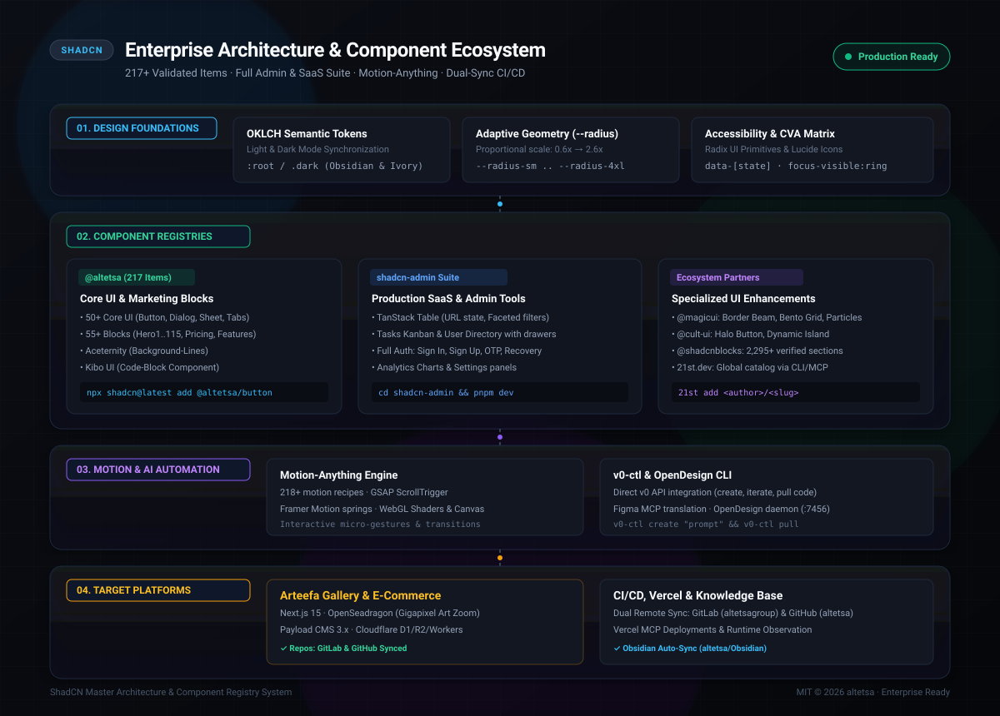

# ShadCN — Enterprise UI Components, Blocks & Registry Catalog

[](https://github.com/altetsa/ShadCN/actions/workflows/validate.yml)
[](https://ui.shadcn.com/docs/registry)
[](https://tailwindcss.com)
[](https://react.dev)
[](#-complete-registry-catalog)
[](shadcn-admin/)

An enterprise-grade, comprehensive custom registry, admin dashboard suite, and knowledge base for **shadcn/ui**, **Tailwind CSS v4**, and **React 19 / 18**. Contains **50+ core UI components**, **55+ production marketing blocks**, **20+ admin dashboard components**, **Aceternity UI & Kibo UI components**, the complete **shadcn-admin** template, custom React hooks, developer conventions, and complete architectural documentation.

---

## 🏛️ System Architecture



---

## 🚀 Quick Start


Install any component or block directly using the official [shadcn CLI](https://ui.shadcn.com/docs/cli) without manual setup:

```bash
# Add Core UI Components
npx shadcn@latest add @altetsa/button
npx shadcn@latest add @altetsa/dialog
npx shadcn@latest add @altetsa/sidebar
npx shadcn@latest add @altetsa/table

# Add Effect & Visual Components (Aceternity & Kibo UI)
npx shadcn@latest add @altetsa/aceternity-background-lines
npx shadcn@latest add @altetsa/kibo-code-block


# Add Admin Dashboard Components (from shadcn-admin)
npx shadcn@latest add @altetsa/admin-confirm-dialog
npx shadcn@latest add @altetsa/admin-password-input
npx shadcn@latest add @altetsa/admin-date-picker
npx shadcn@latest add @altetsa/admin-profile-dropdown
npx shadcn@latest add @altetsa/admin-theme-switch

# Add Marketing & Application Blocks
npx shadcn@latest add @altetsa/hero1
npx shadcn@latest add @altetsa/pricing4
npx shadcn@latest add @altetsa/feature166
npx shadcn@latest add @altetsa/testimonial10

# Add Hooks & Helpers
npx shadcn@latest add @altetsa/use-mobile
npx shadcn@latest add @altetsa/use-copy-to-clipboard
npx shadcn@latest add @altetsa/utils

# Add AI Coding Agent Rules (~/AGENTS.md)
npx shadcn@latest add @altetsa/agent-rules
```

---

## 🖥️ Integrated `shadcn-admin` Dashboard Suite

This repository now embeds the complete production-grade [shadcn-admin](shadcn-admin/) suite (based on satnaing/shadcn-admin):
- **Data Table**: TanStack Table with server/URL state, bulk actions, column visibility, and faceted filters.
- **Features**: Authentication (Sign In, Sign Up, OTP, Forgot Password), Dashboard Overview & Analytics, Tasks Board, Users Management, Chats, Settings, and Error pages (401, 403, 404, 500, 503).
- **Navigation & Layout**: Collapsible responsive sidebar, dynamic header, breadcrumbs, search dialog, and theme switcher.
- **Standalone Development**:
  ```bash
  cd shadcn-admin
  pnpm install
  pnpm dev
  ```


---

## ⚙️ Configuration in `components.json`

To register this catalog under `@altetsa` in any Next.js or Vite project:

```json
{
  "$schema": "https://ui.shadcn.com/schema.json",
  "registries": {
    "@altetsa": "https://raw.githubusercontent.com/altetsa/ShadCN/main/public/r/{name}.json",
    "@shadcnblocks": "https://www.shadcnblocks.com/r/{name}"
  }
}
```

---

## 📦 Complete Registry Catalog (110 Items)

### 1. Core UI Components (50 Items)

| Component | Type | Dependencies / Primitives | Description |
| :--- | :--- | :--- | :--- |
| **`accordion`** | `registry:ui` | `@radix-ui/react-accordion` | Vertically stacked collapsible sections |
| **`alert`** | `registry:ui` | `cva` | Highlighted callouts for user status |
| **`alert-dialog`**| `registry:ui`| `@radix-ui/react-alert-dialog` | Modal dialog interrupting the user with critical content |
| **`aspect-ratio`**| `registry:ui`| `@radix-ui/react-aspect-ratio`| Displays media within a desired aspect ratio |
| **`avatar`** | `registry:ui` | `@radix-ui/react-avatar` | User profile avatar with fallback initials |
| **`badge`** | `registry:ui` | `cva` | Status badges and labels with variant styles |
| **`breadcrumb`** | `registry:ui` | `@radix-ui/react-slot` | Accessible hierarchical navigation breadcrumbs |
| **`button`** | `registry:ui` | `@radix-ui/react-slot`, `cva` | Interactive button supporting sizes, icons, and variants |
| **`calendar`** | `registry:ui` | `react-day-picker`, `date-fns`| Full-featured date picker calendar |
| **`card`** | `registry:ui` | — | Content container with header, content, and footer |
| **`carousel`** | `registry:ui` | `embla-carousel-react` | Motion-enabled carousel with swipe and keyboard controls |
| **`chart`** | `registry:ui` | `recharts` | Composable charting library styled with Tailwind CSS |
| **`checkbox`** | `registry:ui` | `@radix-ui/react-checkbox` | Accessible tri-state checkbox control |
| **`collapsible`** | `registry:ui`| `@radix-ui/react-collapsible`| Expandable/collapsible content drawer |
| **`command`** | `registry:ui` | `cmdk` | Fast, accessible command palette and search bar |
| **`context-menu`**| `registry:ui`| `@radix-ui/react-context-menu`| Right-click context menu |
| **`dialog`** | `registry:ui` | `@radix-ui/react-dialog` | Modal window overlay with accessible focus trapping |
| **`drawer`** | `registry:ui` | `vaul` | Mobile-friendly swipeable drawer component |
| **`dropdown-menu`**| `registry:ui`| `@radix-ui/react-dropdown-menu`| Action menus triggered by button click |
| **`file-tree`** | `registry:ui` | Lucide Icons | Hierarchical file & folder explorer component |
| **`form`** | `registry:ui` | React Hook Form, Radix Label | Form wrapper with integrated validation states |
| **`hover-card`** | `registry:ui` | `@radix-ui/react-hover-card` | Preview card revealed on cursor hover |
| **`input`** | `registry:ui` | — | Text input field with focus ring tokens |
| **`input-otp`** | `registry:ui` | `input-otp` | Accessible one-time password pin input |
| **`label`** | `registry:ui` | `@radix-ui/react-label` | Accessible label for form controls |
| **`magic-card`** | `registry:ui` | Canvas / Lucide | Card featuring gradient border illumination |
| **`menubar`** | `registry:ui` | `@radix-ui/react-menubar` | Desktop-grade application menu bar |
| **`navigation-menu`**|`registry:ui`| `@radix-ui/react-navigation-menu`| Top navigation menu with rich mega-menu dropdowns |
| **`pagination`** | `registry:ui` | — | Pagination controls with previous, next, and ellipses |
| **`popover`** | `registry:ui` | `@radix-ui/react-popover` | Floating popover positioned against anchor triggers |
| **`progress`** | `registry:ui` | `@radix-ui/react-progress` | Determinate progress bar indicator |
| **`radio-group`**| `registry:ui` | `@radix-ui/react-radio-group`| Accessible single-selection radio options group |
| **`resizable`** | `registry:ui` | `react-resizable-panels` | Resizable panel group with split handles |
| **`scroll-area`**| `registry:ui` | `@radix-ui/react-scroll-area`| Custom-styled scrollable viewport with native physics |
| **`select`** | `registry:ui` | `@radix-ui/react-select` | Accessible custom select dropdown |
| **`separator`** | `registry:ui` | `@radix-ui/react-separator` | Horizontal or vertical visual divider |
| **`sheet`** | `registry:ui` | `@radix-ui/react-dialog` | Side sheet drawer overlay for mobile & desktop navigation |
| **`sidebar`** | `registry:ui` | Lucide, Tooltip | Production sidebar layout system with collapse states |
| **`skeleton`** | `registry:ui` | — | Shimmer skeleton loader for placeholder states |
| **`slider`** | `registry:ui` | `@radix-ui/react-slider` | Horizontal range slider control |
| **`sonner`** | `registry:ui` | `sonner` | Modern toast notifications powered by Sonner |
| **`switch`** | `registry:ui` | `@radix-ui/react-switch` | Accessible on/off toggle switch |
| **`table`** | `registry:ui` | — | Responsive table elements with zebra & hover styles |
| **`tabs`** | `registry:ui` | `@radix-ui/react-tabs` | Tabbed content interface with animated indicator |
| **`textarea`** | `registry:ui` | — | Multi-line text input field |
| **`toast`** | `registry:ui` | `@radix-ui/react-toast` | Floating toast alert system |
| **`toaster`** | `registry:ui` | Toast primitives | Container mounting toast alerts |
| **`toggle`** | `registry:ui` | `@radix-ui/react-toggle` | Two-state toggle button |
| **`toggle-group`**|`registry:ui`| `@radix-ui/react-toggle-group`| Group of two-state toggle buttons |
| **`tooltip`** | `registry:ui` | `@radix-ui/react-tooltip` | Contextual popup displayed on focus or hover |

---

### 2. Production Blocks & Page Sections (55 Items)

| Category | Blocks Included in `@altetsa/` | Description |
| :--- | :--- | :--- |
| **Hero Sections** | `hero1`, `hero3`, `hero7`, `hero45`, `hero47`, `hero115`, `hero-section` | Split heroes, screenshot overlays, badge announcements, rating rows, video backdrops |
| **Feature Grids & Bento** | `feature1`, `feature2`, `feature13`, `feature17`, `feature43`, `feature51`, `feature72`, `feature73`, `feature166`, `feature197` | Multi-card bento grids, icon-led lists, alternating media rows, interactive tabs |
| **Pricing & Matrix** | `pricing2`, `pricing4`, `pricing6`, `compare7` | Monthly/yearly billing toggles, highlighted tier cards, feature comparison tables |
| **Social Proof & Stats**| `testimonial10`, `logos8`, `stats8` | Testimonial review cards, partner logo tickers, key metric counters |
| **Call to Action (CTA)**| `cta10`, `cta11`, `banner1` | High-conversion banners and sticky announcement strips |
| **Navbars & Footers** | `navbar1`, `footer2` | Multi-tiered navigation headers and comprehensive multi-column footers |
| **Authentication & Waitlists**| `login1`, `signup1`, `waitlist1` | Clean auth cards with social providers and early access waitlist forms |
| **Case Studies & Code** | `casestudies2`, `casestudy8`, `codeexample1` | Visual customer stories, proof metrics, syntax-highlighted code panels |
| **Articles & Timeline** | `blog7`, `blogpost1`, `content1`, `changelog1`, `timeline9` | Editorial article layouts, company changelogs, chronological roadmaps |
| **Corporate & Services**| `about3`, `careers4`, `community1`, `compliance1`, `contact7`, `download2`, `experience5`, `faq1`, `gallery6`, `integration3`, `list2`, `resource1`, `service1`, `services4`, `team1` | Team galleries, career boards, contact forms, partner directories, FAQ accordions |

---

### 3. React Hooks & Utilities (4 Items)

| Item | Type | Description |
| :--- | :--- | :--- |
| **`use-mobile`** | `registry:hook` | Reactive mobile breakpoint (`768px`) detection hook |
| **`use-media-query`** | `registry:hook` | Custom CSS media query listener hook |
| **`use-copy-to-clipboard`**| `registry:hook` | Clipboard copying with temporary success state timer |
| **`utils`** | `registry:lib` | `cn()` helper function for Tailwind CSS class merging |

---

## 📚 Architectural Documentation & Engineering Guides

All documentation and rules are included in the repository:

- 📖 **[00_shadcn_UI_Overview.md](docs/00_shadcn_UI_Overview.md)**: Architecture overview, design system conventions, and project recipes.
- ⚡ **[Shadcn_cn_Engine.md](docs/Shadcn_cn_Engine.md)**: Deep dive into the `shadcn-ui/cn` engine (30× faster class merging replacing `clsx` and `tailwind-merge`).
- 🧱 **[Shadcnblocks_MCP_Overview.md](docs/Shadcnblocks_MCP_Overview.md)**: Guide to using the official shadcn MCP server with 2,295+ blocks.
- 🔍 **[Shadcn_Component_Discovery.md](docs/Shadcn_Component_Discovery.md)**: CLI and MCP workflows for finding components and blocks.
- 📁 **[Shadcn_UI_Blocks_Repository.md](docs/Shadcn_UI_Blocks_Repository.md)**: Catalog and offline source guide.
- 📐 **[Engineering Rules (`rules/`)](rules/)**:
  - `rules/AGENTS.md`: Code quality & stack guidelines for AI agents.
  - `rules/styling.md`: Styling principles, semantic color tokens, and layout guidelines.
  - `rules/forms.md`: Form accessibility, FieldGroup composition, and validation states.
  - `rules/composition.md`: Compound component rules, dialog accessibility, and radix primitives.
  - `rules/base-vs-radix.md`: Guidance on Base UI vs Radix UI primitives.
  - `rules/customization.md`: Theming, CSS variables, and color schemes.
- ⚡ **[High-Performance `cn` Engine Guides (`docs/cn/`)](docs/cn/)**:
  - `docs/cn/aliasing.md`: Aliasing `tailwind-merge` and `clsx` in Next.js and Vite.
  - `docs/cn/build-setup.md`: Compile-time table generation via `cn build`.
  - `docs/cn/how-it-works.md`: Engine internals and benchmark methodology.

---

## ⚡ MCP Server Support

This repository works natively with the [shadcn MCP Server](https://ui.shadcn.com/docs/registry/mcp). AI assistants (Cursor, VS Code Copilot, Claude Code, Codex, Antigravity) can search, inspect, and install items from `@altetsa` automatically:

```bash
# Initialize MCP for your environment
npx shadcn@latest mcp init --client cursor
npx shadcn@latest mcp init --client vscode
npx shadcn@latest mcp init --client claude
npx shadcn@latest mcp init --client codex
```

---

## 🛠️ Validation & Local Development

```bash
# Validate all 110 registry items
npx shadcn@latest registry validate ./registry.json

# Rebuild public static JSON files
python3 ./scripts/build_registry.py
```

---

## 📄 License
MIT © 2026 [altetsa](https://github.com/altetsa)
